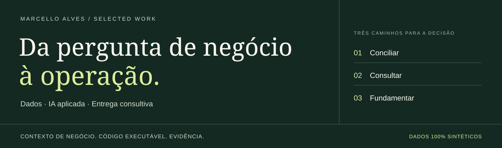

<p align="right"><strong>Português</strong> · <a href="README.en.md">English</a></p>



# Marcello Alves

**Dados & IA aplicada · Entrega consultiva de ponta a ponta**

Traduzo problemas de negócio em sistemas que as pessoas conseguem usar, entender e operar. Conecto descoberta, integração de dados, implementação e adoção — com uma forma de trabalhar alinhada a **Forward Deployed Engineering**.

Sou Head de Business Intelligence, com trajetória em mercado financeiro, consultoria, empreendedorismo e impacto social. Minha experiência combina construção técnica, formação de equipe e comunicação com a liderança. [Conheça minha trajetória no LinkedIn →](https://www.linkedin.com/in/marcelloaf/)

**Este repositório demonstra como eu resolvo problemas.** Os casos são reconstruções independentes com código novo, organização fictícia e dados 100% sintéticos. Nenhum sistema ou resultado institucional é disponibilizado aqui.

---

## Comece pelo que você quer avaliar

| Seu interesse | Caminho de leitura |
| :--- | :--- |
| **Negócio e atuação consultiva** | [Como trabalho](docs/how-i-work.md) → [caso de conciliação](projects/reconciliation/README.md) |
| **Arquitetura e qualidade técnica** | [Arquitetura](docs/architecture.md) → [código](portfolio_lab/) → [testes](tests/) |
| **Ver funcionando** | Execute o comando abaixo ou leia a [evidência gerada](reports/README.md) |

## Três problemas, três demonstrações

### 01 / Conciliação com contexto

**Uma ausência no ERP é uma pendência real ou apenas uma carga atrasada?**

Cruzo duas fontes, preservo a evidência de cada decisão e separo divergências, cancelamentos, duplicidades e diferenças de atualização. O resultado é uma fila de revisão com responsável sugerido, sem confundir exceção com perda financeira.

`Python` `Decimal` `Qualidade de dados` `Rastreabilidade`

[Caso e decisões →](projects/reconciliation/README.md) · [Código →](portfolio_lab/reconciliation.py) · [Resultado reproduzível →](reports/reconciliation.json)

### 02 / Perguntas de negócio, consultas governadas

**Como dar autonomia ao gestor sem ampliar o acesso aos dados?**

Uma pergunta em linguagem natural seleciona uma métrica aprovada. O sistema mostra o SQL, os parâmetros e a definição do indicador, consultando apenas a unidade permitida. Perguntas fora do catálogo são recusadas.

`Python` `SQL / SQLite` `Camada semântica` `Escopo por identidade`

[Caso e decisões →](projects/governed-analytics/README.md) · [Código →](portfolio_lab/analytics.py) · [Resultado reproduzível →](reports/analytics.json)

### 03 / Evidência antes da resposta

**Qual procedimento está vigente e de onde veio essa informação?**

Recupero trechos de um acervo fictício respeitando papel e vigência do documento. A resposta é extrativa, cita a versão consultada e admite quando não há evidência suficiente. Uma avaliação pequena torna os limites inspecionáveis.

`Python` `BM25` `Retrieval para RAG` `Avaliação` `Controle de acesso`

[Caso e decisões →](projects/evidence-desk/README.md) · [Código →](portfolio_lab/evidence.py) · [Avaliação reproduzível →](reports/evaluation.json)

## Execute em um minuto

Requisito: **Python 3.11 ou superior**. Apenas biblioteca padrão; não precisa instalar pacotes, configurar banco ou fornecer API key.

```bash
git clone https://github.com/Marcello-ADB/Portfolio.git
cd Portfolio
python portfolio.py demo
python -m unittest discover -s tests -v
```

No macOS/Linux, use `python3` se necessário. No Windows, `py -3` também funciona. Se o terminal não exibir acentos, use `python -X utf8`.

Experimente os limites, além do caminho feliz:

```bash
python portfolio.py ask "orçado versus realizado" --identity manager_north
python portfolio.py ask "orçado versus realizado" --identity controller
python portfolio.py search "vencimento de contrato" --role operations
python portfolio.py search "vencimento de contrato" --role legal
python portfolio.py evaluate
```

Na terceira linha, o sistema se abstém; na quarta, encontra a fonte autorizada. Os papéis da CLI são **personas de teste**, não um login de produção.

## O que está comprovado aqui

| Evidência local | Escopo |
| :--- | :--- |
| **36 documentos, 9 estados de conciliação** | Cenários sintéticos com resultado esperado declarado |
| **3 intenções de consulta** | SQL parametrizado e isolamento dos dados carregados por persona |
| **12 cenários de retrieval e abstenção** | Suíte sintética de regressão, sem generalização para produção |
| **26 testes automatizados** | Regras, isolamento, entradas inválidas, vigência e determinismo |

A experiência profissional é descrita no LinkedIn e no currículo. As métricas acima pertencem exclusivamente a estes demos. [Leia a política de dados e autoria](docs/privacy-and-provenance.md).

## Minha forma de trabalhar

**Entender a decisão → conhecer as fontes → construir um recorte útil → validar com a operação → transferir conhecimento.**

Minha base profissional inclui Power BI, SQL, Python, PostgreSQL/Supabase, n8n e integrações de IA. Para este portfólio, escolhi um núcleo pequeno e executável para facilitar a avaliação das regras e dos trade-offs. [Veja o que está implementado e o que seria necessário em produção](docs/architecture.md).

## Explore

[Método consultivo](docs/how-i-work.md) · [Runbook](docs/runbook.md) · [Arquitetura e decisões](docs/architecture.md) · [Referências](docs/references.md) · [Próximos casos](docs/roadmap.md) · [Roteiro de apresentação](docs/demo-guide.md)

---

**Vamos conversar sobre dados, decisão e operação.** [LinkedIn](https://www.linkedin.com/in/marcelloaf/) · [GitHub](https://github.com/Marcello-ADB)

Código demonstrativo sob [licença MIT](LICENSE). Não representa produto oficial de qualquer empregador ou cliente.
