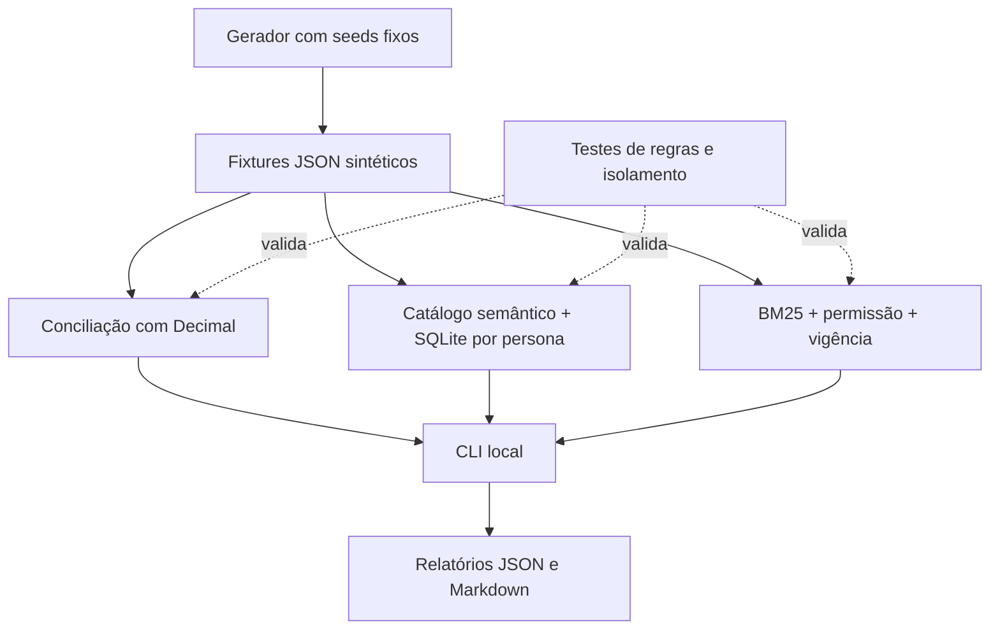
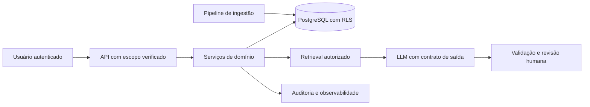

# Arquitetura e decisões

[Voltar ao portfólio](../README.md)

## O que existe no repositório

Não há serviço em background, requisição de rede, variável de ambiente obrigatória, banco persistente ou componente de produção. O comando `--write-report` escreve somente a pasta `reports/` do repositório; o gerador escreve somente `data/synthetic/`.

| Componente | Implementado | Limite |
|---|---|---|
| Conciliação | Comparação de snapshots, completude, revisão e evidência | Não integra ERP nem automatiza cobranças |
| Analytics | Intenções aprovadas, escopo local e SQL read-only | Não gera SQL livre; não autentica usuários |
| Evidence desk | BM25, papéis, versões e extração literal | Não usa LLM, embeddings ou interpretação jurídica |
| Avaliação | 26 testes e 12 perguntas de regressão | Não mede disponibilidade, carga, produção ou qualidade generativa |
| CI | Workflow para Linux e Windows, Python 3.11/3.12 | Só valida este repositório sintético |

## ADR 001 — Reconstrução independente

**Contexto:** demonstrar problemas enfrentados profissionalmente sem publicar material institucional.

**Decisão:** código novo, entidades fictícias, dados gerados e sem relação linha a linha com registros reais. O portfólio preserva tipos de problema e raciocínio de solução, não a implementação de um empregador.

**Consequência:** não é uma cópia anonimizada de um sistema real e não permite reproduzir seus resultados. A experiência profissional permanece no CV/LinkedIn; a prova técnica aqui é a execução dos demos.

## ADR 002 — Um repositório curado

**Contexto:** uma primeira visita precisa encontrar uma narrativa e conseguir executar o trabalho.

**Decisão:** três casos em um repositório, com entrada única, documentação por caso e funções independentes. Evito fragmentar a primeira versão em muitos repositórios vazios.

**Consequência:** os casos compartilham a CLI e o gerador. Poderão ser separados quando cada um justificar manutenção independente.

## ADR 003 — Biblioteca padrão e modo offline

**Contexto:** o avaliador pode não ter Docker, credenciais ou orçamento de API.

**Decisão:** Python 3.11+, SQLite em memória, JSON e `unittest`. Toda a execução local fica inspecionável e reproduzível.

**Consequência:** este recorte não demonstra diretamente Power BI, n8n, PostgreSQL/RLS, Cloudflare ou integração com LLM. São competências profissionais mencionadas e possíveis evoluções, não componentes escondidos do demo.

## ADR 004 — SQL a partir de contratos

**Decisão:** o planejador escolhe entre templates aprovados; entradas não reconhecidas falham de forma explícita. Não há parser de SQL gerado nem regex apresentada como barreira suficiente para SQL arbitrário.

**Consequência:** cobertura de linguagem limitada. Em uma evolução com LLM, a saída seria uma intenção tipada, validada contra o catálogo e o escopo autorizado no servidor.

## ADR 005 — Evidência extrativa antes de geração

**Decisão:** testar autorização, vigência, retrieval e citação antes de adicionar geração.

**Consequência:** não há alucinação generativa a medir, mas ainda há erro de relevância possível. Hit@3 não é uma medida de verdade da resposta. A suíte sintética não substitui avaliação independente.

## Arquitetura de evolução — ainda não implementada

A implementação exigiria identidade verificada, limites de consulta, credenciais isoladas por função, avaliação de prompt injection, testes contra vazamento, trilha persistente e política de retenção. O acesso de ingestão não seria usado para consultas de usuários.
