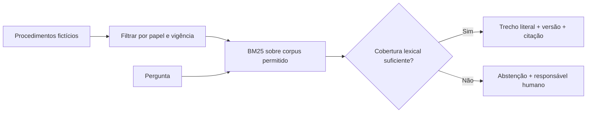

# 03 / Evidência antes da resposta

**Procedimentos acessíveis, fontes rastreáveis, limites visíveis.**

[Portfólio](../../README.md) · [Código](../../portfolio_lab/evidence.py) · [Testes](../../tests/test_evidence.py) · [Avaliação](../../reports/evaluation.json)

> Baseline de retrieval para uma futura aplicação RAG. Usa BM25 e resposta extrativa. Não usa embeddings, LLM, banco vetorial ou documentos de uma organização real.

## A conversa de negócio

O time conhece parte dos procedimentos, mas os documentos mudam e o acesso varia por função. Encontrar uma resposta plausível não basta: ela precisa vir de uma versão vigente e de um documento que aquela pessoa pode consultar.

**Decisão a apoiar:** localizar a regra documentada ou encaminhar a pergunta quando a evidência não for suficiente.

Na descoberta, eu perguntaria quais documentos são a fonte oficial, quem aprova versões, como são revogados acessos e quais perguntas exigem avaliação humana. Uma resposta sem fonte não encerra o processo.

## Recorte implementado



A base contém oito documentos lógicos e nove versões. Um procedimento de reembolso mudou de cinco para dez dias em abril de 2026. Isso permite verificar tanto uma consulta atual quanto uma consulta histórica.

## Decisões que importam

**Permissão antes do ranking.** Documentos não autorizados são removidos antes de calcular frequências do corpus. Um documento privado não pode mudar nem o texto nem o score recebido por outro papel.

**Vigência explícita.** Intervalos são fechados no início e abertos no fim: `[valid_from, valid_until)`. Versões vigentes sobrepostas para o mesmo documento interrompem a resposta.

**Citação verificável.** A referência `DOC-002@v2#p1` aponta para ID, versão e parágrafo do fixture. O corpo retornado é literal.

**Abstenção conservadora.** Há um limiar de cobertura lexical de 55%, com ao menos dois termos coincidentes quando a pergunta tem dois ou mais termos úteis. Esse score não é probabilidade de verdade nem detector de perguntas respondíveis.

## Experimente

```bash
python portfolio.py search "prazo de reembolso" --as-of 2026-06-30
python portfolio.py search "prazo de reembolso" --as-of 2026-03-31
python portfolio.py search "vencimento de contrato" --role operations
python portfolio.py search "vencimento de contrato" --role legal
python portfolio.py evaluate
```

O primeiro par devolve versões diferentes do procedimento. O segundo par mostra o efeito da autorização. A avaliação contém **oito perguntas positivas e quatro negativas**.

| Medida | O que responde |
|---|---|
| Hit@3 | A fonte esperada apareceu nos três primeiros resultados? |
| MRR | Quão cedo apareceu a fonte esperada? |
| Acerto de abstenção | O mecanismo recusou perguntas negativas da suíte? |

As perguntas e respostas esperadas foram escritas junto com o demo. **12/12 não significa 100% de qualidade em perguntas reais.** Os testes também verificam isolamento, histórico, conflito de versões e entradas vazias.

## Limites e evolução

BM25 depende de palavras semelhantes. A extração pode devolver um trecho relacionado que não resolve toda a pergunta. Não há interpretação de contexto, detecção abrangente de prompt injection ou avaliação de geração. Texto hostil num documento é devolvido como citação; não é executado, mas deve ser tratado antes de qualquer integração com um LLM.

Para evoluir: corpus autorizado e aprovado por domínio; conjunto de avaliação independente; retrieval híbrido; geração condicionada a evidências com validação de citações; testes de injeção e vazamento; rastreio de custo/latência; fluxo de correção do documento de origem. O uso de IA só faz sentido se melhorar a experiência sem perder a capacidade de conferir a resposta.
