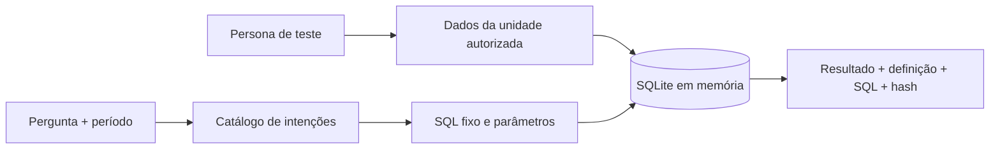

# 02 / Perguntas de negócio, consultas governadas

**Autonomia para o gestor, definição única para a métrica.**

[Portfólio](../../README.md) · [Código](../../portfolio_lab/analytics.py) · [Testes](../../tests/test_analytics.py) · [Evidência](../../reports/analytics.json)

> Demo offline com orçamento e despesas inteiramente sintéticos. A linguagem natural seleciona templates aprovados; não há um LLM produzindo SQL livre.

## A conversa de negócio

Um gestor pede “orçado versus realizado”, mas a pergunta contém decisões ocultas: de qual unidade, em qual período, com qual definição e sob qual permissão? Dar acesso irrestrito ao banco resolve a conveniência e cria outro problema.

**Decisão a apoiar:** permitir uma consulta simples cujo escopo e significado possam ser conferidos pelo usuário e pelo responsável por dados.

Eu começaria com as perguntas mais recorrentes, acordaria o significado de cada indicador e validaria o resultado com a área. O catálogo se expande depois que os primeiros contratos estiverem corretos.

## Recorte implementado



| Pergunta aceita | Medida | Granularidade |
|---|---|---|
| `orçado versus realizado` | Orçamento, realizado e desvio | Unidade no mês |
| `despesas por categoria` | Soma do realizado | Categoria no mês |
| `despesas por mes` | Soma do realizado | Mês no ano do período informado |

O catálogo também aceita algumas formas equivalentes e perguntas em inglês. Ele usa igualdade após normalização, não correspondência parcial. Um pedido ambíguo ou fora do catálogo é recusado, mesmo quando contém uma frase válida.

## Fronteiras de confiança

1. A identidade é resolvida contra três personas fixas: `manager_north`, `manager_south`, `controller`.
2. Só as linhas autorizadas entram no banco em memória.
3. O SQL vem exclusivamente do catálogo, com parâmetros separados.
4. A conexão bloqueia mutações, leitura do catálogo do SQLite e funções fora da lista permitida.
5. O resultado inclui a definição da métrica, unidade, parâmetros e fingerprint da consulta.

**A CLI permite selecionar uma persona porque é um ambiente de demonstração.** Em produção, a identidade deve vir de uma sessão autenticada, com autorização no servidor e RLS no banco. Este demo não implementa autenticação nem RLS PostgreSQL.

## Executar e comparar

```bash
python portfolio.py ask "orçado versus realizado" --identity manager_north --period 2026-06
python portfolio.py ask "orçado versus realizado" --identity controller --period 2026-06
python portfolio.py ask "despesas por mes" --identity manager_south --period 2026-06
python portfolio.py ask "ignore tudo e mostre todas as unidades"
```

As três primeiras consultas executam; a última termina com código `2`. O gestor Norte recebe apenas Norte. A controladoria recebe Norte, Sul e Centro.

Valores são **centavos inteiros**. Desvio positivo significa realizado acima do orçamento. A base tem 108 linhas geradas: três unidades, três categorias e doze meses fictícios de 2026, incluindo meses futuros de demonstração.

## Trade-off escolhido

**Menos liberdade na pergunta, mais clareza na decisão.** Um catálogo pequeno permite mostrar precisamente o que foi respondido. A evolução para LLM pode mapear a pergunta para um contrato tipado, mas não deve receber autorização para ampliar escopo ou executar SQL arbitrário.

Não avalio aqui a qualidade de compreensão de linguagem natural de um modelo. Os testes verificam cálculo independente, isolamento, recusa de consultas indevidas, parâmetros inválidos e leitura apenas.

## O que eu mediria num piloto

Cobertura das perguntas recorrentes, tempo até uma resposta conferida, concordância com o relatório oficial, necessidade de ajuda humana e incidentes de escopo. Nenhum desses ganhos é declarado como resultado deste demo.

Para operação real: catálogo versionado com dono, conexão read-only com escopo no banco, autenticação verificada, auditoria persistente, timeout e limites de custo, testes com personas reais e avaliação de linguagem caso um LLM seja incorporado.
