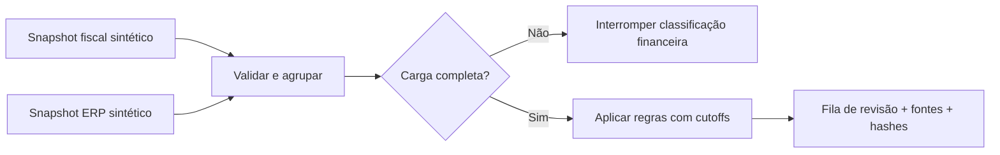

# 01 / Conciliação com contexto

**Da divergência aparente à fila que a operação consegue tratar.**

[Portfólio](../../README.md) · [Código](../../portfolio_lab/reconciliation.py) · [Testes](../../tests/test_reconciliation.py) · [Evidência](../../reports/reconciliation.json)

> Caso demonstrativo independente. Organização, documentos, valores e cenários são fictícios. O domínio fiscal serve de contexto; não há cálculo tributário ou parecer fiscal.

## A conversa de negócio

Uma controladoria recebe listas de documentos de dois sistemas. O primeiro atualiza durante o dia; o ERP chega por fotografia periódica. A equipe enxerga um volume de divergências, mas não consegue distinguir problema real, atraso de atualização e cadastro duplicado.

**Decisão a apoiar:** quais registros precisam de investigação agora, por qual equipe e com qual evidência?

Antes de implementar, eu validaria quatro pontos com o responsável: a identidade de um documento; o marco de completude de cada carga; o significado de cancelamento; e quem resolve cada tipo de exceção. Essas definições mudam o resultado mais do que a escolha da ferramenta.

## Recorte implementado



O gerador produz **36 chaves de documento**, em nove cenários. As fontes têm **28 linhas fiscais e 32 linhas de ERP**, incluindo quatro duplicidades intencionais no ERP. O resultado conserva os IDs de cada origem.

| Situação | Comportamento | Razão de negócio |
|---|---|---|
| Fontes concordam até R$ 0,01 | `matched` | Tolerância explícita, sem float |
| Valor diverge | `amount_mismatch` | Revisão com diferença calculada |
| Documento falta em carga completa | `missing_erp` / `missing_fiscal` | Investigar ausência |
| Emissão posterior ao cutoff da outra fonte | `awaiting_erp` / `awaiting_fiscal` | Esperar evidência antes de cobrar |
| Ambos cancelados | `cancelled` | Excluir da fila ativa |
| Status de cancelamento diverge | `state_conflict` | Revisão humana |
| Chave com mais de um candidato | `ambiguous` | Resolver duplicidade, sem match arbitrário |
| Carga incompleta ou linha rejeitada | `incomplete_snapshot` | Suspender a fila financeira |

Cutoff é a data **até a qual a fonte declara completude**. Ela pode conter alguns documentos mais recentes, sem garantir cobertura completa desses dias.

## Decisões que importam

**Chave composta.** Empresa, fornecedor, série e número. Usar apenas número geraria associações indevidas entre empresas. Zeros à esquerda do número são normalizados; a origem permanece identificada pelo ID.

**Dinheiro exato.** Valores entram como texto com duas casas decimais e são comparados com `Decimal`. A demo rejeita `NaN`, floats e formatos ambíguos.

**Falha de carga é problema de dados.** Uma linha inválida não vira silenciosamente um documento ausente. A execução é marcada como incompleta e não cria cobrança financeira.

**Reprodutibilidade.** A ordem dos arquivos não muda decisões, IDs de evidência ou hashes. Não há escrita de volta, e-mail ou baixa automática.

## Executar e conferir

Na raiz do repositório:

```bash
python portfolio.py reconcile
python -m unittest discover -s tests -p test_reconciliation.py -v
```

Saída esperada: quatro documentos por estado; **16 exceções acionáveis** para revisão. Os quatro grupos acionáveis são ausência no ERP, ausência no fiscal, divergência de valor e conflito de cancelamento.

**Isso não significa economia, perda ou recuperação de dinheiro.** A demo prova a classificação dos cenários declarados, e não impacto financeiro real.

## O que eu mediria num piloto

Percentual de exceções confirmadas pela equipe; tempo entre detecção e resolução; quantidade de cobranças indevidas por atraso de carga; taxa de rejeição de dados. A medição exigiria baseline anterior ao piloto e validação dos responsáveis.

## Limites e passagem à produção

Não há notas fiscais reais, integração com ERP, tratamento tributário, armazenamento de tratativas ou autenticação. Para um piloto: contrato de extração por fonte, armazenamento persistente, controle de acesso, fila com atribuição de responsável, histórico de decisão e validação do cutoff pelo dono do dado. O estado do workflow deve continuar separado da regra de conciliação.
